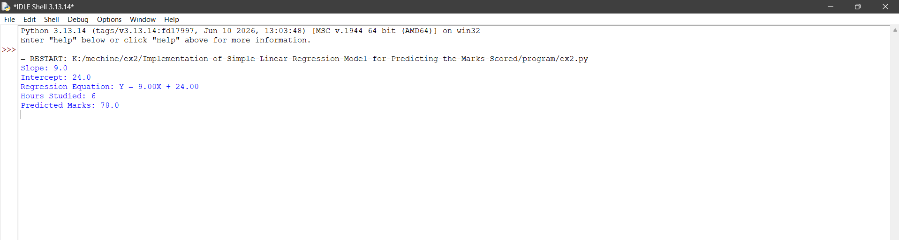

# Implementation-of-Simple-Linear-Regression-Model-for-Predicting-the-Marks-Scored

## AIM:
To write a program to predict the marks scored by a student using the simple linear regression model.

## Equipments Required:
1. Hardware – PCs
2. Anaconda – Python 3.7 Installation / Jupyter notebook

## Algorithm
1. Import the required libraries, NumPy and Matplotlib.
2. Initialize the independent variable X (hours studied) and dependent variable Y (marks scored).
3. Calculate the slope and intercept using the least squares method.
4. Predict the marks using the linear regression equation and plot the actual data points with the regression line.

## Program:
```
import numpy as np
import matplotlib.pyplot as plt

# Hours studied (X) and marks scored (Y)
X = np.array([1, 2, 3, 4, 5])
Y = np.array([35, 40, 50, 60, 70])

# Calculate mean values
mean_x = np.mean(X)
mean_y = np.mean(Y)

# Calculate slope
m = np.sum((X - mean_x) * (Y - mean_y)) / np.sum((X - mean_x) ** 2)

# Calculate intercept
b = mean_y - m * mean_x

# Regression equation
print("Slope:", round(m, 2))
print("Intercept:", round(b, 2))
print("Regression Equation: Y = {:.2f}X + {:.2f}".format(m, b))

# Predict marks for 6 hours of study
hours = 6
predicted_marks = m * hours + b

print("Hours Studied:", hours)
print("Predicted Marks:", round(predicted_marks, 2))

# Plot actual data and regression line
Y_pred = m * X + b

plt.scatter(X, Y, color="blue", label="Actual Marks")
plt.plot(X, Y_pred, color="red", label="Regression Line")

plt.xlabel("Hours Studied")
plt.ylabel("Marks Scored")
plt.title("Simple Linear Regression - Marks Prediction")
plt.legend()
plt.grid(True)
plt.show()

```

## Output:



## Result:
Thus the program to implement the simple linear regression model for predicting the marks scored is written and verified using python programming.
